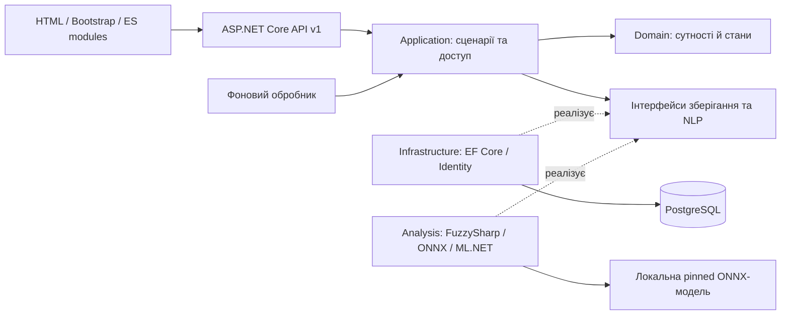
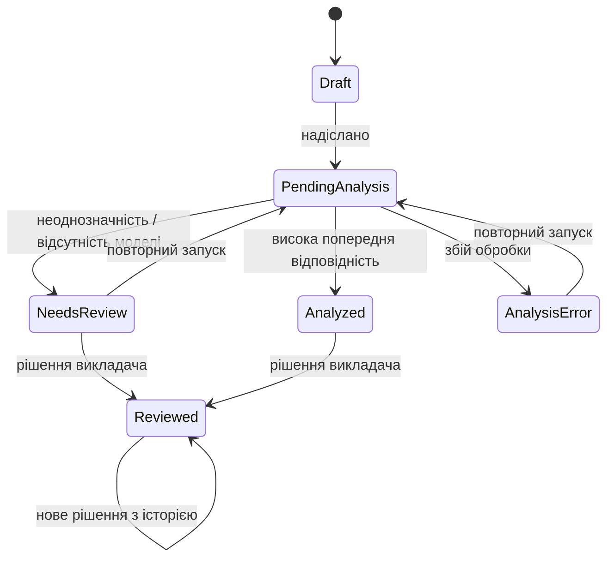

# Архітектура ПЛАВС

Модульний моноліт: один процес API обслуговує статичний клієнт, прикладні сценарії й локальний NLP. PostgreSQL зберігає навчальні дані, облікові записи, чергу аналізу та історію. Для роботи інтерфейсу не потрібні CDN або зовнішні AI-сервіси.

Domain не залежить від EF чи HTTP. Application має DTO, валідацію, ресурсний доступ і сценарії роботи. Його `IPlavsDb` використовує EF Core як узгоджений query abstraction; це свідомий компроміс простоти моноліту замість універсального репозиторію. Infrastructure реалізує PostgreSQL, Identity та транзакційні блокування. Analysis не має залежності від бази. Api є composition root, завершує HTTP-контракт і запускає обробник.

## Життєвий цикл відповіді

1. Публікація тесту вимагає активних питань однієї дисципліни, додатних балів і призначених груп.
2. Початок спроби перевіряє групу, дисципліну, розклад і роль. Одному студенту дозволено одну спробу кожного тесту; повторний запит повертає ту саму спробу.
3. Спроба містить JSONB-знімок текстів, ревізій, активних еталонів, **лише погоджених** варіацій, понять, балів та версії налаштувань. Зміни банку не змінюють знімок.
4. Чернетки зберігаються на сервері. Збереження перевіряє власника, дедлайн, стан і належність питання до спроби.
5. Надсилання атомарно фіксує спробу й відповіді у `PendingAnalysis`; порожні питання також фіксуються. Повторне надсилання не дублює записи.
6. BackgroundService вибирає збережену чергу кожні 2 секунди. Після перезапуску процесу черга зберігається. Прострочені спроби надсилаються з уже збереженими чернетками.
7. Результат стає `Analyzed` або `NeedsReview`. Непередбачений збій переводить його в `AnalysisError`; текст відповіді збережений раніше й залишається в БД.
8. Ручне рішення додається окремим незмінним записом. `Defer` залишає відповідь на перевірці; інші рішення дають `Reviewed`.

Надсилання, редагування банку, погодження, перевірка й зміна налаштувань виконуються з PostgreSQL `pg_advisory_xact_lock` та Serializable-транзакціями. Унікальні ключі є останнім захистом від дублювання. Серіалізаційний конфлікт повертає HTTP 409; клієнт оновлює дані й повторює дію. Локальний semaphore обмежує навантаження ONNX; блокування БД координують різні API-процеси.

## Доступ і конфіденційність

- Identity хешує паролі; вимоги: 12 символів, регістри, цифра, спеціальний символ. Невдалий вхід має узагальнене повідомлення, lockout після 5 спроб та IP-ліміт 10 запитів за хвилину. За reverse proxy довіряйте лише його конкретному IP.
- HttpOnly/SameSite Strict cookie, обмежений строк сесії, security stamp. API перевіряє блокування й stamp на кожному автентифікованому запиті: зміна ролі або блокування відкликає стару сесію.
- Усі запити зміни даних, включно з login/logout, вимагають antiforgery-токен. Після входу клієнт отримує новий токен, прив'язаний до особи.
- Teacher має доступ лише до призначених дисциплін і студентів груп цих дисциплін. Самої ролі недостатньо. Administrator не отримує права редагувати питання чи оцінки; його звіти узагальнені.
- Студент бачить лише власні спроби й відповіді. Окрема DTO-проєкція виключає еталони, поняття, внутрішні пояснення та налаштування. Бал і коментар відкриваються лише за `ResultsVisible`.
- ORM використовує параметризовані запити; пошук не складає SQL із введених значень. HTML-тексти екрануються перед вставленням. CSV захищений від формульної ін'єкції; XLSX записує текст як текстові значення.
- API-відповіді мають `Cache-Control: no-store`; налаштовані CSP, frame-ancestors, nosniff і Referrer-Policy. Swagger з послабленням script CSP доступний лише в Development.
- Аудит містить користувача, тип дії та ID об'єкта, без паролів і текстів відповідей. SensitiveDataLogging EF не ввімкнено. Знімки й історія містять навчальні тексти в БД, де до них застосовуються права сервера.

## Розгортання

Production використовує зовнішньо підготовлені міграції, унікальні секрети та HTTPS. Для TLS-термінації вкажіть `ReverseProxy__KnownProxy`; не довіряйте довільним forwarded-заголовкам. Сховище ключів Data Protection повинно бути доступне лише користувачу сервісу й резервуватися. Docker volume забезпечує сталість ключів, але шифрування диска/volume та захист резервних копій налаштовує оператор.

Версія не містить інтеграції із зовнішньою університетською SSO чи розподіленої job-системи; для поточного моноліту використано Identity і стійку до перезапусків чергу в PostgreSQL. Для багатовузлового розгортання треба спільне сховище cookie-ключів, довірений proxy та спостереження за розміром черги.
