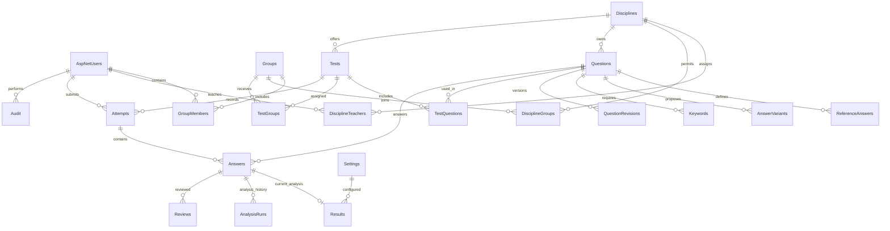

# Дані та зв'язки

Схема створюється EF Core Migrations, а не `EnsureCreated`. Початкова міграція та ModelSnapshot збережені у `src/PLAVS.Infrastructure/Migrations`. Identity використовує стандартні AspNetUsers, AspNetRoles і таблиці зв'язків; AppUser додає ім'я, ознаку блокування й дату створення.



Усі навчальні сутності мають UUID, CreatedAt та UpdatedAt у UTC (`timestamptz`). Читабельні позначення API не є ключами. GUID seed-питань детерміновано походять від `Q001`…`Q070`; інші ID генеруються при створенні.

| Таблиця | Призначення та ключові обмеження |
|---|---|
| Disciplines, Groups | Дисципліни та групи з архівуванням; унікальна назва групи |
| GroupMembers | Унікальна пара GroupId/UserId |
| DisciplineTeachers | Унікальна пара DisciplineId/UserId |
| DisciplineGroups | Призначення груп дисципліні |
| Questions | Статус, ревізія та concurrency token; індекс DisciplineId/Status |
| ReferenceAnswers | Один основний еталон: частковий унікальний індекс QuestionId WHERE IsPrimary; додаткові деактивуються |
| AnswerVariants | Pending/Approved/Rejected/Inactive, автор, джерело, дата й автор рішення; індекс QuestionId/Status |
| Keywords | Унікальна пара QuestionId/Term, вага (0;100], масив синонімів PostgreSQL text[] |
| QuestionRevisions | Незмінний JSONB-знімок попереднього питання, унікальна пара QuestionId/Revision |
| Tests, TestQuestions, TestGroups | Порядок питань, додатні бали, розклад, тривалість 1–480 хв, призначення груп |
| Attempts | Одна спроба на TestId/StudentId; JSONB-знімок усіх умов; дедлайн і статус |
| Answers | Одна відповідь на AttemptId/QuestionId; індекс Submitted/Status/CreatedAt для черги |
| Results | Поточний результат; L/M/K у [0;1], S у [0;100], nullable M/S; версії й JSONB-деталі |
| AnalysisRuns | Незмінний повний результат кожного запуску; індекс AnswerId/CreatedAt |
| Reviews | Незмінні рішення, коментар, перевіряльник; індекс AnswerId/CreatedAt |
| Settings | Нова версія при зміні; сума ваг 1, β > 0 та впорядковані пороги — CHECK-обмеження |
| Audit | Незмінні метадані критичних операцій; індекс CreatedAt |

Використані записи архівуються, а не видаляються. FK переважно Restrict запобігають втраті історії. Заміна поточних понять або складу тесту до першої спроби може видаляти службові дочірні записи; попередні знімки питання й спроби зберігають їх значення. Історія налаштувань, рішень, запусків та аудиту захищена від ORM-оновлення/видалення.

## Резервування

```bash
sh database/scripts/backup.sh
sh database/scripts/restore.sh artifacts/backups/FILE.dump plavs_restore_check
```

Відновлення навмисно створює **нову** БД і відмовляється перезаписувати вже наявну. Перевірте кількість питань, FK, облікові записи та вибіркові результати у відновленій БД перед перемиканням застосунку. Крім PostgreSQL, резервуйте секрети розгортання й ключі Data Protection. Модель можна повторно завантажити за manifest.
